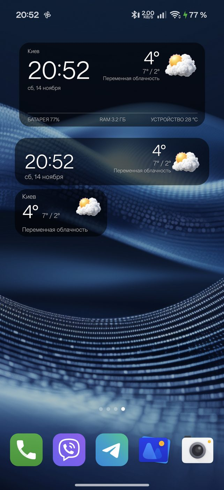
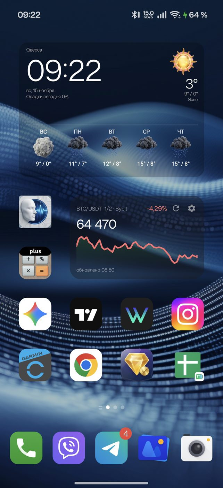
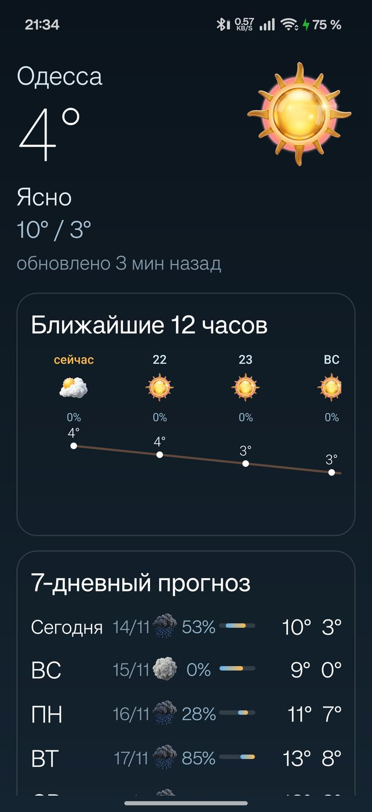
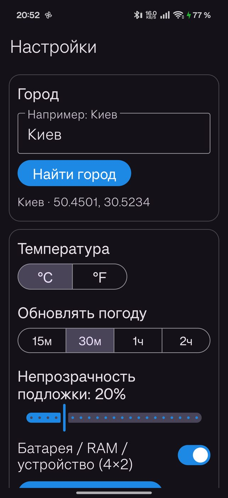
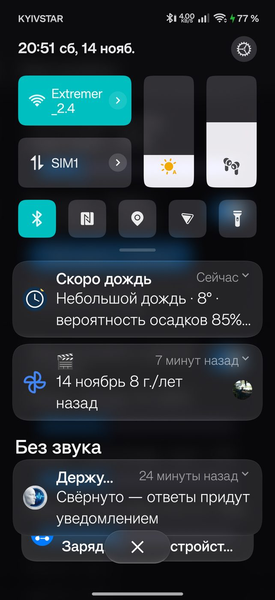

# Прозрачные часы и погода (ClockWeather)

Android-приложение под БРАТИКА: прозрачные домашние виджеты «часы + погода» в духе
Transparent Clock & Weather, но без трекеров, рекламы и лишних разрешений.

Репозиторий: https://github.com/rioorob-hash2/ClockWeather-Android

## Скриншоты

| Рабочий стол | Виджет 4×3 | Экран погоды |
|---|---|---|
|  |  |  |

| Настройки | Уведомление |
|---|---|
|  |  |

- Пакет: `com.bratik.clockweather`
- minSdk 32 / targetSdk 36 / compileSdk 35, Kotlin 2.0.21, AGP 8.7.3
- Погода: Open-Meteo (без ключа), геокодер Open-Meteo
- Сборка: `powershell -ExecutionPolicy Bypass -File tools/run.ps1 apk` (и `test`)
- APK: `app/build/outputs/apk/prod/app-prod.apk` (в git не хранится — см. Releases)

## Что внутри

| Компонент | Файлы |
|---|---|
| Виджеты 2×1 / 4×1 / 4×2 / 4×3 | `widgets/WidgetRender.kt`, `Widget2x1|4x1|4x2|4x3.kt`, `BaseWidgetProvider.kt`, `res/layout/widget_*.xml`, `res/xml/widget_*_info.xml` (+ `xml-v31` с `targetCell*`) |
| Прогноз на 5 дней (4×3) | `widgets/ForecastStrip.kt` — полоса рисуется в Bitmap (5 колонок, RemoteViews-безопасно) |
| Минутный тик часов | `widgets/ClockTicker.kt` (AlarmManager на границу минуты), `ClockTickReceiver.kt` |
| Погода | `data/OpenMeteo.kt` (сеть + `OpenMeteoParser` без сети), `notify/WeatherWorker.kt` (WorkManager, 15–180 мин) |
| Уведомления | `notify/AlertRules.kt` (чистая логика), `notify/Notifier.kt` (канал, RU-текст) |
| Настройки | `ui/SettingsActivity.kt`, `res/layout/activity_settings.xml` |
| Конфиг при добавлении виджета | `widgets/WidgetConfigActivity.kt` |
| Иконки погоды | `res/drawable-xxhdpi/wx_*.png` — сгенерированы с нуля (не из чужого APK) |
| Шрифты | `res/font/roboto_thin|light|regular|medium.ttf` (Apache 2.0) |

## Проверено

- `tools/run.ps1 test` — 42 юнит-теста зелёные (`FormatTest` 13, `AlertRulesTest` 17, `OpenMeteoParseTest` 12).
- Устройство CPH2745 (Android 17, SDK 37): APK установлен, настройки открываются и сохраняют состояние.
- Все три виджета добавлены на рабочий стол и рисуются: город, время, дата, t°, min/max, описание, иконка,
  строка датчиков (батарея/RAM/температура устройства) в 4×2.
- Минутный тик: время на виджетах меняется без открытия приложения.
- Тап по виджету запускает обновление погоды (WorkManager) и перерисовку.
- Уведомление «Скоро дождь» показано на устройстве (проверено через временный отладочный приёмник, затем удалён).
- Разрешение POST_NOTIFICATIONS запрошено из настроек, диалог системный.
- Прозрачность подложки: переключение 20% → 70% меняет вид виджета на обоях.
- Прогноз на 5 дней (4×3) собран в APK 1.1, 50 юнит-тестов зелёные.
- APK 1.2: 4×3 перекомпонован (время 84sp, строка «Осадки сегодня N%», прогноз снизу) —
  проверено на устройстве; тап по любому виджету открывает экран погоды
  (`WeatherActivity`): текущая погода, лента «Ближайшие 12 часов» с ломаной температур,
  список «7-дневный прогноз» с вероятностью осадков и шкалой min—max. Проверено на CPH2745.
- 50 юнит-тестов (добавлены часы/дни/сериализация).

## Ограничения / не проверено

- Пороги уведомлений проверены юнит-тестами, «в поле» — только искусственным снимком погоды
  (в Киеве на момент проверки вероятность осадков 3%, естественный триггер не срабатывал).
- Геолокация как источник координат **не реализована** — город задаётся поиском (геокодер Open-Meteo).
  Разрешение `ACCESS_COARSE_LOCATION` объявлено, но не используется; при желании добавим.
- Температура устройства (`BatteryManager.EXTRA_TEMPERATURE`) есть не на всех прошивках; при отсутствии — прочерк.
- Тема (светлая/тёмная) не вынесена в настройки: виджеты всегда белым текстом (тёмный текст на светлых обоях читается хуже).
- Долгий тап по виджету открывает системное меню лаунчера; настройки — через иконку приложения и
  «изменить» у виджета (`widgetFeatures=reconfiguration`).
- Иконки 256×256 PNG на 7 состояний; «ночные» варианты не рисовались (используются дневные).
